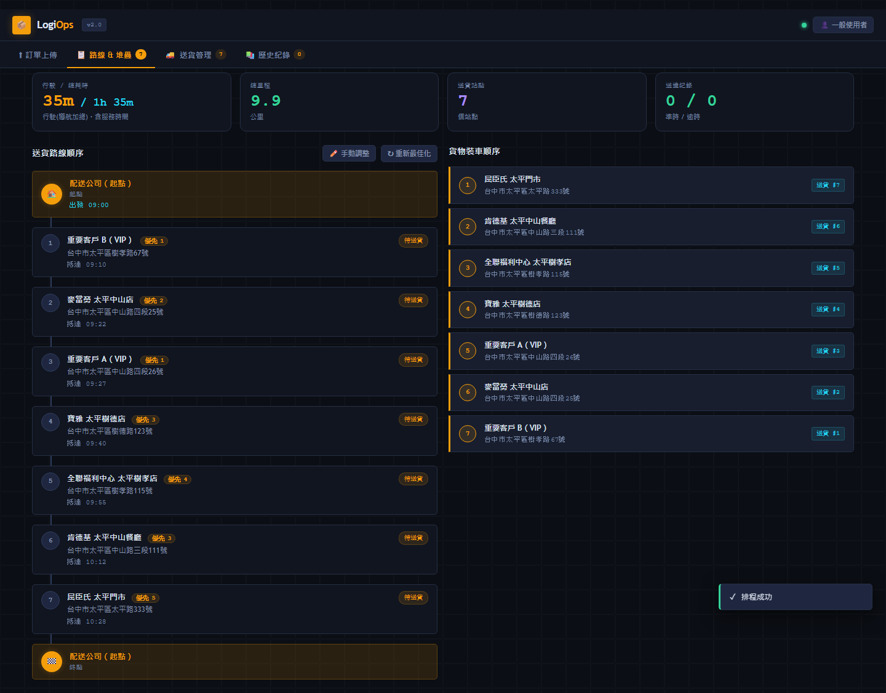
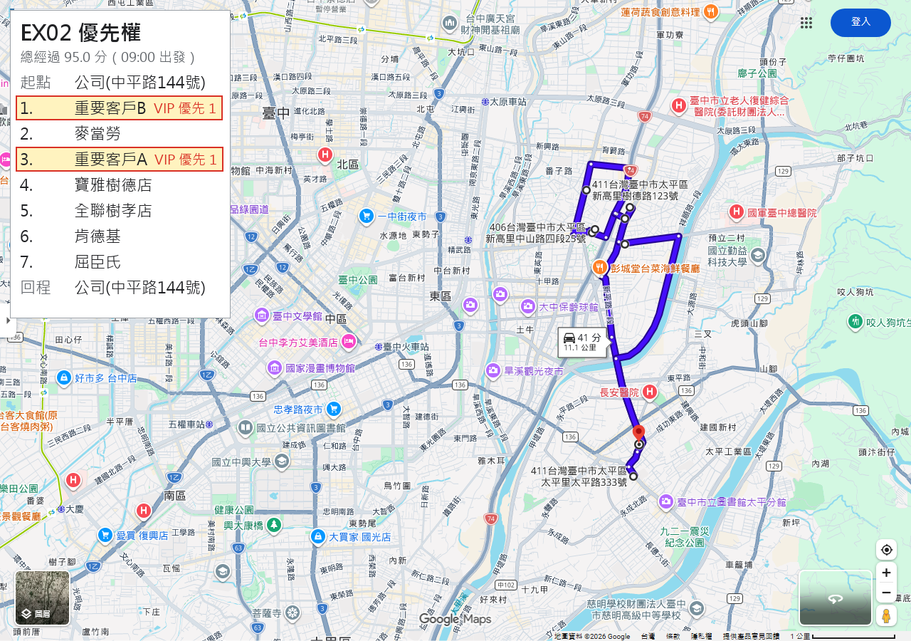

# TSPTW 路線最佳化專案

本專案用來解「有時間窗限制的單車配送路線最佳化」問題，也就是 TSPTW（Traveling Salesman Problem with Time Windows）。

系統會讀取配送地點、地址、客戶時間窗與臨時配送條件，透過 Google Maps Distance Matrix API 取得各點之間的行駛時間與距離，再使用 OR-Tools 或 DP 演算法計算配送順序，最後輸出路線、抵達時間、延誤狀況與 Google Maps 導航網址。

## 系統畫面

**路線規劃與裝車順序** — 左側為依時間窗與優先權排定的配送順序及預估抵達時間，右側同步產生「後送先上」的貨物裝車順序。



**優先客戶處理** — 標記為 VIP／優先權 1 的站點會被排到行程前段，同時仍滿足其餘站點的時間窗。


**Google Maps 導航輸出** — 排定的路線會轉成實際可用的 Google Maps 導航網址，超過 10 點時自動分段。



> 畫面中的站點為以公開地標與連鎖門市建立的示範測資，非真實客戶資料。


## 專題問題定義

### 研究動機與痛點

傳統配送高度依賴資深司機的經驗，例如路線判斷、時間窗取捨、臨時客戶不在家的應變，以及上貨順序安排。這些知識通常透過口耳相傳累積，導致新人培訓成本高且品質不穩定。

主要痛點：

- 隱性人力成本高：路線與裝載經驗過度依賴老手。
- 導師制帶培成本高：老手帶新人時，老手本身配送效率也會下降。
- 複製成效不一：新人學習效果取決於老手表達與新人理解，難以標準化。
- 配送品質不穩：不同司機可能產生不同路線、不同延誤與不同服務體驗。

### 系統定位

本系統定位為「數位導師」，目標是把老手的隱性知識系統化：

- 路徑抉擇：由演算法根據時間與距離自動排序。
- 時間窗判斷：由系統判斷準時、等待、延誤與不可行狀況。
- 臨時事件調整：例如客戶不在家，可延後該點並重新排程。
- 優先客戶處理：固定或重要客戶可設定較高優先權。
- 結束地點彈性：司機送完貨後可停在較近的店家或休息點。

### 本版實作範圍

目前已實作：

- 小規模單車配送路線最佳化。
- 嚴格時間窗與軟性時間窗。
- 客戶臨時延後配送。
- 自訂起點、終點與候選結束點。
- 客戶優先權。
- Google Maps 導航網址分段。

目前尚未完整實作：

- 一維車廂後進先出（LIFO）條碼上貨驗證。
- 車容量、箱數、重量限制。
- 多車配送。

LIFO 可由最終 `route_indices` 逆序推導裝載順序，後續可再擴充成「條碼掃描上貨檢查」功能。

## 專案結構

```text
TSPTW/
├─ index.html app.html app.js style.css        ← 前端（靜態主機直接吃根目錄，路徑不可搬）
│  cursor_glow.js landing_scroll.js excel_validation.js
├─ API_main.py                                  ← FastAPI 入口（Render 以 uvicorn API_main:app 啟動，不可搬）
├─ config.json requirements.txt                 ← 設定與相依套件（以工作目錄相對路徑讀取）
├─ matrix_cache.json                            ← 距離矩陣快取（執行時自動寫入）
├─ core/          後端核心模組（一律 from core.xxx import）
├─ scripts/       CLI 與一次性工具（從專案根目錄執行）
├─ samples/       範例輸入 payload 與 Excel
├─ tests/         單元測試（python -m unittest discover -s tests）
├─ test_cases/    測試情境與前端範例資料（frontend_*/*.json 會被前端執行期 fetch，不可搬）
├─ outputs/       執行產出：路線結果 JSON、報告截圖（執行時自動建立；本版未附歷史產出）
└─ 報告用測資/     報告與簡報引用的測資 Excel
```

| 檔案 | 用途 |
| --- | --- |
| `config.json` | 集中管理可調設定，例如輸入檔、輸出檔、API key、求解器、timeout、快取檔。 |
| `core/app_config.py` | 讀取設定檔，合併 `config.json` 與單次 payload。 |
| `core/input_validator.py` | 驗證輸入型別、上下限、時間格式與 Google Maps 限制。 |
| `core/route_service.py` | 核心服務流程，串接驗證、地圖矩陣、求解器與輸出格式。 |
| `core/google_maps_api.py` | Google Maps Distance Matrix 呼叫與矩陣快取（含途中重排的快取子集合切片）。 |
| `core/or_tools_engine.py` | OR-Tools 求解器。 |
| `core/dp_engine.py` | DP 求解器，適合小規模驗證。 |
| `API_main.py` | FastAPI 入口，提供 `/api/v1/optimize-route`。 |
| `scripts/run_routing.py` | 本機執行入口（不經 API 跑一次最佳化）。 |
| `scripts/compare_ortools_strategies.py` | 比較不同 OR-Tools 搜尋策略。 |
| `tests/test_input_validation.py` | 輸入限制與上下限測試。 |

> **搬檔案前必讀**：`API_main.py`、根目錄的前端檔、`test_cases/frontend_*/` 都被外部設定或執行期路徑綁住
> （Render 啟動指令、靜態主機根目錄、`app.js` 的 fixture fetch），搬移會讓線上服務直接壞掉。
> `scripts/` 下的 CLI 會自行把專案根目錄加進 `sys.path`，但 `config.json` 等相對路徑仍以工作目錄為準，請在根目錄下指令。

## 安裝需求

```bash
pip install fastapi uvicorn googlemaps ortools pydantic
```

執行測試不需要額外測試框架，使用 Python 內建 `unittest`。

## 設定檔

主要設定在 `config.json`。

**API 金鑰不要放進 `config.json`（會進版控）**。金鑰載入順序為：`config.json` → `config.local.json`（已列入 `.gitignore`，格式同 `config.json`、只放要覆蓋的欄位）→ 環境變數（依序 `ROUTING_API_KEY_0814`、`ROUTING_API_KEY`、`GOOGLE_MAPS_API_KEY`，取第一個有值的；Render 後台目前用 `ROUTING_API_KEY_0814`），後者覆蓋前者。本機開發建議建立：

```json
{
  "google_maps_api_key": "你的 AIza… 金鑰"
}
```

存成 `config.local.json` 即可，不需改 `config.json`。

```json
{
  "input_payload_file": "samples/request_payload_bast.json",
  "output_result_file": "outputs/routing_result_central_dp.json",
  "google_maps_api_key": "",
  "operation_type": "delivery",
  "solver": "ortools",
  "solver_timeout_seconds": 5,
  "depot_index": 0,
  "current_index": null,
  "start_index": null,
  "end_index": null,
  "end_candidate_indices": [],
  "completed_indices": [],
  "cancelled_indices": [],
  "skipped_indices": [],
  "matrix_cache_file": "matrix_cache.json"
}
```

常用欄位：

| 欄位 | 型別 | 限制 | 說明 |
| --- | --- | --- | --- |
| `input_payload_file` | string | 必須是可讀 JSON 檔 | 本機執行輸入檔。 |
| `output_result_file` | string | 必須可寫入 | 本機執行輸出檔。 |
| `google_maps_api_key` | string | 不可為空，除非 payload 有提供 | Google Maps API key。 |
| `operation_type` | string | `delivery` 或 `receiving` | 行程種類。送貨與收貨都不設硬性站點上限，25 點只是建議適用規模。未填時預設 `delivery`。 |
| `solver` | string | `ortools` 或 `dp` | 求解器。 |
| `solver_timeout_seconds` | int | 1 到 300 | 求解器最長等待秒數。 |
| `depot_index` | int | 0 到 `locations.length - 1` | 預設起終點。 |
| `current_index` | int 或 null | 0 到 `locations.length - 1` | 途中重排時司機目前所在地點。若提供，會作為新的實際起點。 |
| `current_time_seconds` | time 或 int | 24 小時制或 0 到 86399 | 途中重排當下時間，用來讓目前位置的路線時間從現況開始。 |
| `start_index` | int 或 null | 0 到 `locations.length - 1` | 實際出發點。 |
| `end_index` | int 或 null | 0 到 `locations.length - 1` | 固定結束點。 |
| `end_candidate_indices` | int[] | 每個值都必須是合法 index | 候選結束點，例如附近休息店家。 |
| `completed_indices` | int[] | 每個值都必須是合法 index | 已完成配送，途中重排時排除。 |
| `cancelled_indices` | int[] | 每個值都必須是合法 index | 取消配送，途中重排時排除。 |
| `skipped_indices` | int[] | 每個值都必須是合法 index | 本輪暫時跳過，途中重排時排除。 |
| `matrix_cache_file` | string | JSON 檔名 | Google Maps 矩陣快取。 |

### OR-Tools 搜尋策略

目前可在 `config.json` 或 API payload 中設定 OR-Tools 策略：

```json
{
  "ortools": {
    "first_solution_strategy": "PATH_CHEAPEST_ARC",
    "local_search_metaheuristic": "GUIDED_LOCAL_SEARCH"
  }
}
```

目前預設策略：

```text
PATH_CHEAPEST_ARC + GUIDED_LOCAL_SEARCH
```

可用於比較的測試策略：

```text
PARALLEL_CHEAPEST_INSERTION + GUIDED_LOCAL_SEARCH
```

可用比較腳本同時跑兩種策略：

```bash
python scripts/compare_ortools_strategies.py
```

輸出會包含每種策略的 `total_time_minutes`、`total_distance_km`、`total_lateness_minutes` 與 `route_indices`。

## 輸入格式

最小 payload：

```json
{
  "google_maps_api_key": "你的 Google Maps API Key",
  "solver": "ortools",
  "solver_timeout_seconds": 5,
  "depot_index": 0,
  "service": {
    "default_service_time_seconds": 600
  },
  "locations": [
    {
      "id": 0,
      "name": "公司",
      "address": "台中市...",
      "time_window": ["08:00", "23:59:59"]
    },
    {
      "id": 1,
      "name": "客戶 A",
      "address": "台中市...",
      "time_window": ["09:00", "18:00"],
      "priority": 1,
      "service_time_seconds": 300,
      "status": "pending"
    }
  ]
}
```

### locations 欄位限制

| 欄位 | 型別 | 限制 | 說明 |
| --- | --- | --- | --- |
| `id` | int | 必填 | 地點 ID。 |
| `name` | string | 必填，非空 | 顯示名稱。 |
| `address` | string | 必填，非空 | Google Maps 可辨識地址。 |
| `time_window` | array | 必須兩個值 | `[最早可抵達, 最晚可抵達]`。 |
| `rescheduled_time_window` | array | 必須兩個值 | 客戶臨時改約後的新時間窗；提供後會覆蓋本次計算的有效時間窗。 |
| `priority` | int | 1 到 5 | 數字越小越優先。 |
| `delay_by_seconds` | int | 0 到 86400 | 將最早可配送時間往後推幾秒。 |
| `delay_until_seconds` | time 或 int | 24 小時制或 0 到 86399 | 延後到指定時間後才能配送。 |
| `service_time_seconds` | int | 0 到 86400 | 此站卸貨、簽收或等待時間。 |
| `status` | string | `pending`、`in_progress`、`completed`、`delayed`、`cancelled`、`skipped` | 途中狀態；`completed`、`cancelled`、`skipped` 會在重排時排除。 |

若單站未提供 `service_time_seconds`，系統會使用 `service.default_service_time_seconds`。目前預設值為 `600` 秒，也就是每站平均上下貨/服務時間 10 分鐘。

服務時間只會計入實際配送站點；路線出發點不計服務時間，若最後一站只是回到原點，也不會計入上下貨/等待時間。回傳明細中的 `charged_service_time_seconds` 代表該站在本次路線中實際被計入的服務秒數。

### Excel 上傳欄位

前端上傳 Excel 時會讀取第一列作為標題列，標題列不會被當成站點。第二列開始才是地點資料；送貨 Excel 與收貨 Excel 都只需要放實際送貨/收貨站點。內建測資與前端預設公司統一為「國立勤益科技大學」，地址為「411030臺中市太平區坪林里中山路二段57號」；所有測試 payload 都將它放在 `locations[0]` / `depot_index=0`。正式使用時仍可由前端「系統管理員模式」調整公司地點。`id=0` 不是 Excel 客戶資料的保留值，仍可作為一般站點；只有舊 Excel 第一筆資料的地址與公司地點相同時，前端才會視為舊公司列並在站點清單中排除。若沒有上傳收貨 Excel，就代表只有送貨流程。

目前前端只會自動對應下列欄位。未列在表中的欄位即使放在 Excel，也不會進入後端 payload；`status`、`rescheduled_time_window`、`delay_by_seconds` 等欄位屬於途中回報/API 重排狀態，不是目前 Excel 匯入欄位。

| 欄位用途 | 是否必填 | 建議欄名 / 可辨識欄名 | 格式與限制 | 未填時行為 |
| --- | --- | --- | --- | --- |
| 地點 ID | 必填 | `ID`、`id`、`編號`、`序號` | 整數且每列唯一。這是顯示與資料庫同步識別用，路線計算仍以陣列 index 為準。 | 無法正確對應必要欄位。 |
| 地點名稱 | 必填 | `Name (名稱)`、`Name`、`name`、`名稱`、`地點名稱`、`站點名稱` | 非空文字。 | 無法正確對應必要欄位。 |
| 地址 | 必填 | `Address (地址)`、`Address`、`address`、`地址`、`配送地址` | 非空文字，必須能被 Google Maps 辨識。 | 無法正確對應必要欄位。 |
| 時間窗開始 | 選填 | `Time Window Start`、`tw_start`、`time_window_start`、`開始時間`、`最早` | 建議 `HH:MM` 或 `HH:MM:SS` 24 小時制，例如 `09:00`。也相容 Excel 時間格式與舊秒數格式。不可晚於結束時間。 | `00:00`；公司起點時間由畫面上的預計出發時間決定，預設 `09:00`。 |
| 時間窗結束 | 選填 | `Time Window End`、`tw_end`、`time_window_end`、`結束時間`、`最晚` | 建議 `HH:MM` 或 `HH:MM:SS` 24 小時制，例如 `18:00`；最晚到 `23:59` / `23:59:59`。不可輸入 `24:00`、`25:00`、`18:99`。 | `23:59`。 |
| 優先權 | 選填 | `Priority`、`priority`、`優先權`、`優先序` | 整數 `1` 到 `5`；數字越小越優先。這是軟性偏好，不保證硬性排第一。 | 使用系統預設優先權 `3`。 |
| 單站服務時間 | 選填 | `Service`、`service_time_seconds`、`服務時間` | 正整數秒數，合法範圍 `0` 到 `86400`。建議填秒數，例如 10 分鐘填 `600`。目前 Excel 匯入只有大於 0 的值會覆蓋預設。 | 使用預設 `600` 秒；送貨代表平均上下貨時間，收貨代表平均收貨停留時間。 |

Excel 至少要有 1 筆實際站點。送貨與收貨 Excel 都不設硬性站點上限：24 筆實際站點（加上公司共 25 個正式地點）只是本專題個案的建議適用規模，超過時前端只顯示效能警告仍會載入，但應依站數增加 `solver_timeout_seconds` 並進行效能測試。途中重排可再額外加入 1 個 `virtual_current_position=true` 的虛擬目前位置；虛擬目前位置由前端產生，不需要也不應放在 Excel。

前端會在載入 Excel 時逐列驗證後才更新目前清單；任一列不合法時，整份檔案不會載入，並會顯示前 3 項錯誤及剩餘錯誤數。驗證包含：必要欄位不可空白、ID 必須是唯一整數、時間必須是合法 24 小時制、開始時間不可晚於結束時間、優先權必須是 `1` 到 `5`、服務時間必須是 `0` 到 `86400` 整數秒。送貨與收貨實際站點超過 24 筆都只顯示效能警告，不會拒絕資料。`24:00`、`09:60`、優先權 `0/6` 等資料會直接擋下，不再靜默修正或改用預設值。

收貨 Excel 的上傳入口會在送貨 Excel 載入後才顯示，避免還沒有送貨清單時先建立收貨行程。

### 正常測資完整功能測試

`報告用測資/正常測資_送.xlsx` 與 `報告用測資/正常測資_收.xlsx` 的衍生功能測試共 19 項，涵蓋基準路線、優先級、等待、軟性遲到、單站服務時間、途中完成／取消／跳過／改約、送貨合法上下限、收貨 30 站，以及 Excel 錯誤攔截。（完整測試產出與 22 張路線對比圖體積較大，未隨本版釋出。）

可重建及重跑：

```bash
node test_cases/report_function_tests/build_workbooks.mjs D01
python test_cases/report_function_tests/run_function_tests.py
node test_cases/report_function_tests/capture_map_screenshots.mjs
powershell -NoProfile -ExecutionPolicy Bypass -File test_cases/report_function_tests/generate_route_comparisons.ps1
node test_cases/report_function_tests/build_results_workbook.mjs
```

`build_workbooks.mjs` 可將最後參數換成 `D01` 到 `D04`、`R01` 到 `R05` 或 `L01` 到 `L08`。完整測試紀錄另保存於 `test_cases/report_function_tests/results_2026-07-15.md`。

### 大量站點測資

大規模情境測資共 31 個送貨點，用來驗證取消站點硬上限後的表現，其中 5 站帶客戶指定時間窗、其餘為 09:00–18:00。站數較多時建議把畫面右上角的「逾時(秒)」調到 30 秒以上。（原始測資取自合作業者的實際配送清單，涉及商業資料故未隨本版釋出；可改用 `報告用測資/` 內以公開地標建立的測資重現流程。）

可重新產生：

```bash
python test_cases/build_changhua_workbook.py
```

### 手動 / 丟檔案新增訂單

除了 Excel 上傳，前端也可用「➕ 新增訂單」建立訂單（手動填單，或在同一個視窗丟檔案批次新增），入口有三處：訂單上傳頁（尚未上傳 Excel 也可直接建單）、送貨資料預覽列、送貨／收貨管理頁。

- 表單欄位：客戶/地點名稱與地址必填；時間窗、優先權（1–5）、服務時間（分鐘，送後端前自動轉秒）選填，留空用預設。訂單 ID 由系統自動編號（現有最大 ID + 1）。
- 地址真實性驗證：送出前會呼叫後端 `POST /api/v1/validate-address`（Google Geocoding）確認地址可導航——查無此地址、或只到行政區層級（如只填「台中市」）都會被擋下；丟檔批次則自動略過無法定位的列並提示筆數。Geocoding 僅部分符合時會提示 Google 實際定位的地址供確認。後端未設定金鑰或驗證服務離線時軟性放行（提示已略過驗證）。
- 丟檔案批次新增：modal 底部「📄 選擇檔案批次新增」，接受 `.xlsx/.xls/.csv`，欄位辨識規則與送貨 Excel 相同（名稱、地址必填）；名稱/地址空白、時間窗頭尾顛倒、公司列（ID=0 或地址同公司）的列會自動略過並提示；訂單 ID 一律由系統重新編號。
- 新訂單與 Excel 訂單共用同一份資料來源；若 Excel 缺少選填欄位（如優先權），系統會自動補上欄位再寫入。
- 尚未排程：訂單加入預覽清單，按「⚡ 送出後端排程」一併計算。
- 已排程 / 配送途中：訂單（單筆或整批）接在 `locations` 尾端（既有站點 index 不變），自動觸發重排；途中新增會帶目前狀態與時間重算剩餘路線，若後端回傳失敗會自動撤回本次新增的訂單。
- 收貨模式：按「開始收貨」建立收貨行程後也可新增收貨點（手動或丟檔案），寫回收貨資料源並固定收貨起點重排剩餘收貨路線（與收貨回報事件同一條規則）；收貨行程開始前請直接更新收貨 Excel。收貨點 ID 接續收貨清單最大 ID（排除收貨起點 9900 與虛擬點）。
- 送貨與收貨新增都不設硬性筆數上限；送貨以「現有站數＋本批筆數」檢查是否超過建議規模 24 筆（連同公司共 25 個正式地點），超過只提示、仍會新增並重排，但站數越多越應提高 timeout。

Google Maps Distance Matrix 一次最多查詢 10 個 origins/destinations 的分塊大小；專案預設 `google_maps.chunk_size=10`，超過會由後端分批處理。導航網址也受 Google Maps URL 限制，`navigation.max_points_per_url` 預設與上限皆為 10，系統會自動拆成多段導航連結。

### 時間格式限制

新資料建議使用 24 小時制字串：

```json
["08:00", "18:30"]
```

也可精確到秒：

```json
["08:00:00", "23:59:59"]
```

合法範圍：

- 最早：`00:00` 或 `00:00:00`
- 最晚：`23:59` 或 `23:59:59`
- 不可輸入 `24:00`、`25:00`、`18:99`
- 開始時間不可晚於結束時間

目前程式仍保留舊測資的秒數格式相容，例如 `[0, 86399]`，範圍必須是 0 到 86399。但新輸入建議統一使用 `HH:MM` 或 `HH:MM:SS`。

原本測資中的 `100000` 是用來暫時撇除時間窗限制；現在已改成合法上限 `86399`，代表今天 23:59:59 前都可配送。

## 節點數限制

目前測試與驗證採用：

| 行程 | 最少正式地點 | 最大正式地點 | 說明 |
| --- | --- | --- | --- |
| 送貨 | 2 | 無硬性上限 | 25 點（公司加 24 個送貨點）是專題個案的建議適用規模，超過仍可使用。 |
| 收貨 | 2 | 無硬性上限 | 25 點內是專題個案的建議適用規模，超過仍可使用。 |

專題定位與目前效能驗證以 25 個節點內的小規模單車收送貨為主，但這是適用規模，不代表超過 25 點不能執行。大量站點仍使用 OR-Tools，並依站數、時間窗密度與優先級複雜度調整 timeout；實測 32 個地點（公司加 31 個送貨點）以 `solver_timeout_seconds=30` 可在單次求解內回傳完整路線。
途中重排若需要表示「司機目前正在某個客戶地址，但該客戶之後還要再配送」，前端可額外加入 1 個 `virtual_current_position=true` 的虛擬目前位置；這個點只作為重排起點，不計入建議規模的計算。

## Google Maps 限制

### Distance Matrix 分批限制

```json
{
  "google_maps": {
    "chunk_size": 10
  }
}
```

`chunk_size` 限制為 1 到 10。超過 10 會被驗證器擋下。

### 導航網址點數限制

```json
{
  "navigation": {
    "max_points_per_url": 10
  }
}
```

Google Maps 導航網址每段最多放 10 個點：

- 1 個 origin
- 最多 8 個 waypoints
- 1 個 destination

若整條路線超過 10 個點，系統會自動切成多段網址。`max_points_per_url` 設超過 10 會報錯。

## 軟性時間窗

```json
{
  "constraints": {
    "allow_late_arrival": true,
    "late_penalty_per_second": 1000,
    "waiting_time_cost_per_second": 1,
    "preserve_remaining_order": true,
    "route_order_penalty_per_second": 20,
    "route_order_interval_seconds": 600
  }
}
```

| 欄位 | 型別 | 限制 | 說明 |
| --- | --- | --- | --- |
| `allow_late_arrival` | bool | `true` 或 `false` | 是否允許超時但計算延誤懲罰。 |
| `late_penalty_per_second` | int | 0 到 1000000 | 每延誤 1 秒的懲罰權重。 |
| `waiting_time_cost_per_second` | int | 0 到 1000000 | 每等待 1 秒的成本；預設 `1`，代表等待時間會用實際經過秒數納入路線比較。 |
| `preserve_remaining_order` | bool | `true` 或 `false` | 途中重排時，是否盡量維持剩餘配送順序；預設開啟。 |
| `route_order_penalty_per_second` | int | 0 到 1000000 | 剩餘配送順序的軟性偏好權重。 |
| `route_order_interval_seconds` | int | 1 到 86400 | 剩餘站點排序偏好的時間間隔。 |

若 `allow_late_arrival=true`，配送超過客戶時間窗時不會直接無解，而會找出延誤較少的路線，並在 `route_details[].lateness_seconds` 顯示每站延誤。

`waiting_time_cost_per_second` 用來處理「提早到但客戶還不能收貨」的情況。系統會先算實際到站時間，再等到有效時間窗開始才計算下貨/服務時間；等待分鐘數會顯示在 `route_details[].waiting_time_minutes`。預設值 `1` 代表等待 1 秒就等同增加 1 秒成本，因此系統會在「原地等」與「先送其他站再回來」之間做實際經過時間比較。若設成 `0`，演算法會比較願意提早到現場等待；若調高，會更傾向避開需要等待很久的站點。

`preserve_remaining_order` 主要用在途中重排。當司機已經送到一半，部分客戶臨時延後或取消時，開啟此設定會讓系統盡量維持尚未配送客戶的原本順序，避免只有單一客戶延後，卻導致其他未延後客戶全部被大幅往後挪。這是軟性偏好，若原順序會造成更嚴重延誤，系統仍可調整順序。

`route_order_penalty_per_second` 是維持原順序的權重。數值越高，系統越不想打亂剩餘配送順序；數值越低，系統越偏向純粹用距離、時間窗、等待與延誤成本來決定路線。

`route_order_interval_seconds` 會把剩餘站點依原順序拉開一段偏好時間。預設 `600` 秒代表每個原順序順位相隔 10 分鐘的排序偏好，常見用途是讓未延後客戶大致照原排程處理，同時仍保留重新最佳化的彈性。

## 臨時延後配送

客戶臨時不在家時，可使用：

```json
{
  "delay_by_seconds": 1800
}
```

或：

```json
{
  "delay_until_seconds": "11:30"
}
```

系統會把該點的最早可配送時間往後推，重新計算路線。若因此超過原本最晚時間，會依軟性時間窗設定回報延誤。

## 途中事件與剩餘路線重排

司機配送途中若發生客戶臨時不在、道路延誤、客戶取消、或需要改等待時間，前端應送出完整 `locations`，並附上目前狀態。後端會排除已完成、取消或跳過的站點，從 `current_index` 重新計算剩餘路線。

範例：司機目前在 index `4`，重排當下是 `10:30`，index `0`、`2` 已完成，index `6` 客戶改約到 `14:30` 到 `16:00` 才能收貨。

```json
{
  "current_index": 4,
  "current_time_seconds": "10:30",
  "completed_indices": [0, 2],
  "locations": [
    { "id": 0, "name": "公司", "address": "台中市...", "time_window": ["08:00", "23:59"], "status": "completed" },
    { "id": 1, "name": "客戶 A", "address": "台中市...", "time_window": ["09:00", "18:00"] },
    { "id": 2, "name": "客戶 B", "address": "台中市...", "time_window": ["09:00", "18:00"], "status": "completed" },
    { "id": 3, "name": "客戶 C", "address": "台中市...", "time_window": ["09:00", "18:00"] },
    { "id": 4, "name": "目前位置", "address": "台中市...", "time_window": ["00:00", "23:59"], "status": "in_progress" },
    { "id": 5, "name": "客戶 D", "address": "台中市...", "time_window": ["09:00", "18:00"] },
    { "id": 6, "name": "客戶 E", "address": "台中市...", "time_window": ["09:00", "18:00"], "rescheduled_time_window": ["14:30", "16:00"] }
  ]
}
```

重排後 `route_indices` 仍使用原始 `locations` 的 index，不會改成過濾後的新 index。若需要除錯，可看 `route_details[].active_index` 與 `data.reoptimization`。

途中可更新的欄位：

| 情境 | 建議欄位 |
| --- | --- |
| 已送達 | `completed_indices` 或 `locations[i].status = "completed"` |
| 客戶取消 | `cancelled_indices` 或 `locations[i].status = "cancelled"` |
| 本輪暫時跳過 | `skipped_indices` 或 `locations[i].status = "skipped"` |
| 客戶改約新的可配送時段 | `rescheduled_time_window` |
| 客戶只要求延後且沒有新結束時間 | `delay_by_seconds` 或 `delay_until_seconds` |
| 服務/等待時間變長 | `service_time_seconds` |
| 客戶優先順序改變 | `priority` |
| 司機目前位置改變 | `current_index` |
| 重排當下時間改變 | `current_time_seconds` |

## 起點與結束點

固定起終點：

```json
{
  "start_index": 0,
  "end_index": 9
}
```

提供候選結束點：

```json
{
  "start_index": 0,
  "end_candidate_indices": [7, 8, 9]
}
```

這適合司機送完貨後，就近選擇店家休息或等待下一趟收貨，不必硬性回公司。

前端送貨最終站有三種操作：

- `回公司`：送 `end_index=0`。
- `從送貨點挑選備選`：使用者可勾選多個送貨點，前端送 `end_index=null` 與 `end_candidate_indices=[勾選的送貨點 indices]`，由後端挑選最終休息點。
- `讓系統推薦`：前端送 `end_index=null` 與 `end_candidate_indices=[全部送貨點 indices]`，由後端從全部送貨點中挑選。

不論手動備選或系統推薦，後端成功後會回傳 `selected_end_index`，前端以該點作為已定案的送貨最終站與後續收貨起點。

## 優先客戶

重要客戶可設定：

```json
{
  "priority": 1
}
```

`priority` 合法值為 1 到 5，數字越小越優先。這是軟性偏好，不是強制排序；系統仍會同時考量行駛時間、時間窗與延誤。

優先權參數：

```json
{
  "priority": {
    "default_priority": 3,
    "priority_interval_seconds": 1800,
    "priority_penalty_per_second": 20
  }
}
```

## 本機執行

```bash
python scripts/run_routing.py
```

流程：

1. 讀取 `config.json`。
2. 讀取 `input_payload_file`。
3. 合併設定與 payload。
4. 驗證輸入限制。
5. 取得或讀取 Google Maps 矩陣快取。
6. 執行求解器。
7. 印出結果並寫入 `output_result_file`。

## 啟動 API

```bash
uvicorn API_main:app --host 127.0.0.1 --port 8000
```

API 文件：

```text
http://127.0.0.1:8000/docs
```

Endpoint：

```text
POST /api/v1/optimize-route
```

健康檢查 endpoint：

```text
GET /api/v1/health
```

前端可先呼叫 `/api/v1/health` 確認 API 是否啟動。

## 啟動前端（用 5173 網址開啟）

前端是純靜態網頁（`index.html` 介紹首頁 / `app.html` 系統主頁 / `style.css` / `app.js`），**必須透過 CORS 白名單內的網址開啟**，瀏覽器跨來源 `fetch` 才會被授權。預設白名單包含 `http://127.0.0.1:5173`，因此用 `5173` port 啟動最方便。

在專案資料夾啟動靜態伺服器：

```bash
python -m http.server 5173
```

Windows 也可直接雙擊 `start-frontend.bat`（會在 `127.0.0.1:5173` 啟動並自動開瀏覽器）。

接著用瀏覽器開啟：

```text
http://127.0.0.1:5173/            ← 介紹首頁（index.html）
http://127.0.0.1:5173/app.html    ← 系統主頁（也可從首頁點「🚀 進入系統」）
```

> ⚠️ **不要用 `file://` 直接雙擊 HTML 開啟** → 來源會變成 `null` 被 CORS 擋下，前端會顯示「離線（紅燈）」。

使用前先確認後端已啟動（見上方「啟動 API」），前端右上角的 **API Base** 預設為 `http://127.0.0.1:8000`；若後端在別處，改這個欄位即可。連線正常時右上角狀態燈為綠燈。

可選：載入內建測試資料免再上傳 Excel，於網址加上 `?fixture=` 參數，例如：

```text
http://127.0.0.1:5173/app.html?fixture=taiping
http://127.0.0.1:5173/app.html?fixture=bast
```

> 改了 `app.js` / `style.css` 後若畫面沒更新，請強制重新整理（Ctrl+F5），或提高 `app.html` 中資源的 `?v=` 版本號以破快取。

### 前端呼叫流程

前端每次呼叫 `POST /api/v1/optimize-route` 都應送完整 `locations` 陣列，並保持原始陣列順序不變。`route_indices`、`completed_indices`、`current_index` 等欄位都使用 `locations` 的陣列 index，不使用資料庫 id。

常見流程：

| 情境 | 前端要送的重點 |
| --- | --- |
| 初次排程 | `locations`、`depot_index`，若最後要回公司則送 `end_index=depot_index`。 |
| 每送完一站 | 將該站加入 `completed_indices`，或設 `locations[i].status="completed"`。 |
| 送完後立刻重排 | 送 `current_index=i`、`current_time_seconds="HH:MM"`，並保留完整 `locations`。 |
| 到站發現客戶不在但稍後可收 | 設該站 `status="delayed"`，並填 `rescheduled_time_window=["新開始", "新結束"]`。 |
| 客戶取消 | 將該站加入 `cancelled_indices`，或設 `status="cancelled"`。 |
| 本輪暫時跳過 | 將該站加入 `skipped_indices`，或設 `status="skipped"`。 |
| 現場處理時間變長 | 更新該站 `service_time_seconds`，單位為秒。 |

重排成功後，前端應以 `data.route_indices` 更新剩餘配送順序，以 `data.route_details` 顯示每站到站、等待、開始下貨、完成下貨與延誤資訊。不要在前端自行重新排序路線。

### 前端跨網域 CORS

FastAPI 已設定 CORS，允許以下前端開發網址：

```json
[
  "http://localhost:3000",
  "http://127.0.0.1:3000",
  "http://localhost:5173",
  "http://127.0.0.1:5173"
]
```

若前端使用其他 port，例如 `http://localhost:8080`，請到 `config.json` 的 `api_server.cors_allow_origins` 加入該網址，並重新啟動 API。

## 輸出格式

成功範例：

```json
{
  "status": "SUCCESS",
  "data": {
    "total_time_minutes": 46.0,
    "total_travel_minutes": 36.0,
    "total_service_minutes": 10.0,
    "total_elapsed_minutes": 62.9,
    "total_distance_km": 15.28,
    "total_lateness_minutes": 0.0,
    "route_sequence": ["公司", "客戶 A", "公司"],
    "route_indices": [0, 1, 0],
    "route_details": [],
    "driver_navigation_urls": [
      "https://www.google.com/maps/dir/?api=1..."
    ],
    "selected_start_index": 0,
    "selected_end_index": 0,
    "reoptimization": {
      "mode": "full_route",
      "current_index": 0,
      "active_indices": [0, 1],
      "remaining_delivery_indices": [1],
      "removed_indices": []
    }
  }
}
```

常用欄位：

| 欄位 | 說明 |
| --- | --- |
| `total_time_minutes` | 行駛時間加上下貨/服務時間，不含時間窗等待；保留給既有前端相容使用。 |
| `total_travel_minutes` | 純路線行駛時間，不包含上下貨/服務時間。 |
| `total_service_minutes` | 上下貨、簽收等服務時間合計，不包含等待；出發點與回到原點不計入。 |
| `total_elapsed_minutes` | 從出發到結束的經過時間，包含等待與時間窗造成的空等。 |
| `total_distance_km` | 總距離。 |
| `total_lateness_minutes` | 全路線總延誤。 |
| `route_sequence` | 地點名稱順序。 |
| `route_indices` | 地點 index 順序。 |
| `route_details` | 每站實際抵達、等待、開始下貨、完成下貨、有效時間窗、服務時間、延誤、優先權與延後資訊。 |
| `driver_navigation_urls` | Google Maps 導航網址，超過 10 點會分段。 |
| `selected_start_index` | 實際出發點。 |
| `selected_end_index` | 實際結束點。 |
| `reoptimization` | 途中重排狀態，包含目前位置、仍參與計算的 index、已排除 index。 |

`route_details[]` 時間欄位：

| 欄位 | 說明 |
| --- | --- |
| `arrival_time_seconds` | 司機實際到站時間。若太早到，這個時間會早於有效時間窗開始。 |
| `service_start_time_seconds` | 可開始下貨/簽收的時間，會等到有效時間窗開始後才開始。 |
| `waiting_time_seconds` | 到站後需要等待的秒數。 |
| `waiting_time_minutes` | 到站後需要等待的分鐘數，方便前端直接顯示給司機。 |
| `service_completion_time_seconds` | 下貨/簽收完成時間，等於 `service_start_time_seconds + charged_service_time_seconds`。 |

輸入錯誤範例：

```json
{
  "status": "ERROR",
  "message": "輸入資料格式錯誤: locations[0].time_window[0] 必須是 24 小時制，例如 09:30 或 18:00:00。"
}
```

API 錯誤會使用 HTTP 400 或 500，但 response body 仍維持上方格式。前端可統一讀取 `message` 顯示給使用者。

## 程式流程

```text
config.json
    ↓
core/app_config.py 讀取設定
    ↓
scripts/run_routing.py 或 API_main.py 接收 payload
    ↓
core/app_config.py 合併設定與 payload
    ↓
core/input_validator.py 驗證型別與上下限
    ↓
core/route_service.py 整理地點、延後配送、優先權、起終點
    ↓
core/google_maps_api.py 取得 time_matrix / distance_matrix
    ↓
core/route_service.py 選擇 solver
    ↓
core/or_tools_engine.py 或 core/dp_engine.py 求解
    ↓
core/route_service.py 整理路線、延誤、導航網址
    ↓
scripts/run_routing.py 寫入結果，或 API_main.py 回傳 JSON
```

## 測試

執行：

```bash
python -m unittest discover -s tests
```

目前測試涵蓋：

- 合法 24 小時制時間會轉成秒數。
- `25:00` 這類非法時間會報錯。
- 時間窗開始時間晚於結束時間會報錯。
- 既有秒數格式必須在 0 到 86399 內。
- 地點數少於 2 會報錯；送貨與收貨多於 25 個正式地點都仍可通過（無硬性站點上限）。
- 起點/終點/候選終點 index 超出範圍會報錯。
- `priority` 超出 1 到 5 會報錯。
- `google_maps.chunk_size` 超過 10 會報錯。
- `navigation.max_points_per_url` 超過 10 會報錯。
- 直接呼叫導航網址產生器時，超過 10 點也會報錯。
- 矩陣快取：若快取地址為本次請求的超集合，直接切出子矩陣，不重打 API 也不覆蓋完整快取。
- 設定載入：`config.local.json` 覆蓋 `config.json`、環境變數（`core.app_config.API_KEY_ENV_VARS`）再覆蓋其上。

## 後續建議

- ~~將 Google Maps API key 改用環境變數，避免放在測資或程式碼。~~（已完成：`config.local.json` 與 `ROUTING_API_KEY` 環境變數皆可，repo 內不再存放金鑰。）
- 新增 `.gitignore`，排除 `__pycache__`、快取與輸出結果。
- 擴充 LIFO 裝載順序與條碼掃描驗證。
- 增加車容量、箱數、重量限制。
- 補上 API integration test。
